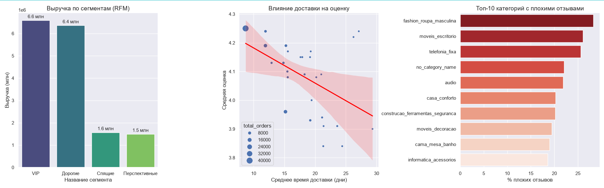

Olist E-Commerce Analytics: Сквозной анализ данных

Описание проекта.
Датасет бразильского маркетплейса Olist (100 000 заказов за 2016–2018 гг.).

Цель: выявить проблемные зоны в логистике, понять качество продукции и сегментировать клиентскую базу для повышения прибыли.

Стек:
- PostgreSQL (загрузка, написание запросов).
- Python (Pandas, NumPy) для обработки данных и RFM-анализа.
- Matplotlib, Seaborn для визуализации.

Ключевые инсайты:

1. Логистика напрямую влияет на оценку клиентов.
Построена диаграмма рассеяния, которая доказывает гипотезу: чем дольше едет посылка, тем ниже оценка.
- В штате Сан-Паулу (SP) доставка занимает 8.6 дней, оценка — 4.24.
- В штате Рорайма (RR) доставка занимает 29.3 дней, оценка падает до 3.90.

  Решение: оптимизировать логистику в северных штатах.

2. RFM-сегментация клиентов.
Клиенты разделены на 4 сегмента по давности покупки и сумме.
- VIP и дорогие сегменты приносят по 6.5 млн реалов.
- Спящие и перспективные — всего по 1.5 млн.

  Решение: сфокусировать маркетинг на удержании VIP-клиентов и на возвращении дорогих клиентов.

3. Качество продукции.
Выявлены категории с наибольшей долей негативных отзывов (1-2 звезды):
- Мужская одежда (fashion_roupa_masculina) — 28% плохих отзывов.
- Офисная мебель (moveis_escritorio) — 26%.

  Решение: провести аудит поставщиков этих категорий.

Как запустить проект
1. Импортируйте CSV-файлы Olist в базу данных PostgreSQL (база olist_db).
2. Установите зависимости: pip install -r requirements.txt.
3. Запустите скрипт: python olist_analysis.py.

Структура проекта
- olist_loader.py — загрузка CSV в базу данных.
- rfm_analysis.py — скрипт с анализом RFM и визуализацией.
- olist_delivered.py — скрипт с анализом доставки.
- olist_final_project.py — итоговый скрипт по всем инсайдам.
